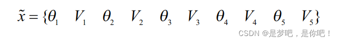
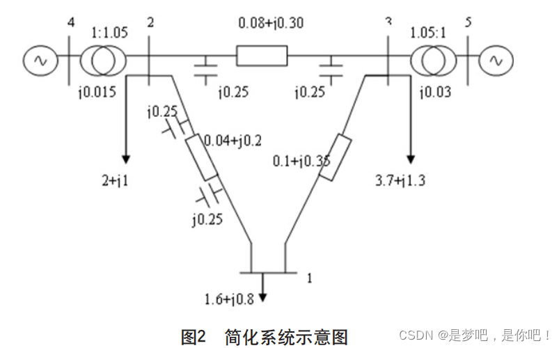
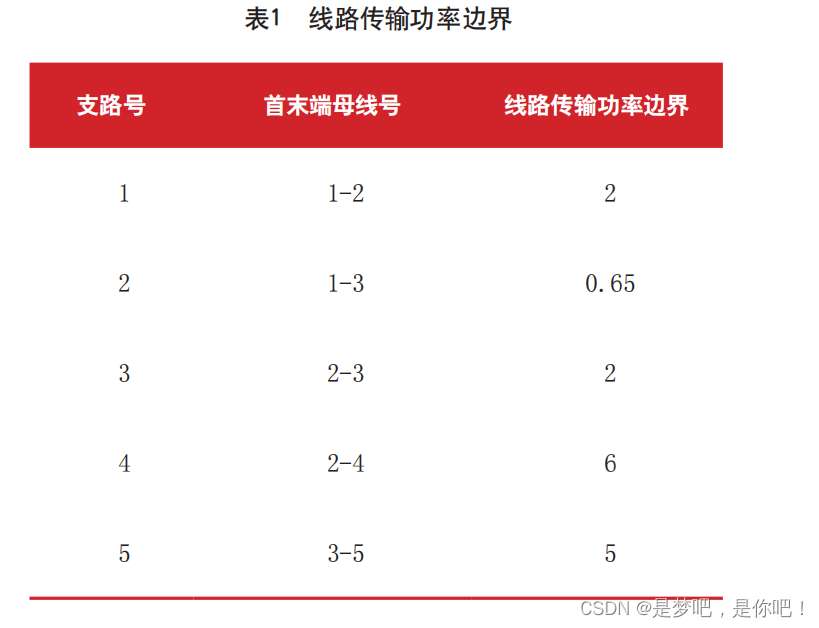
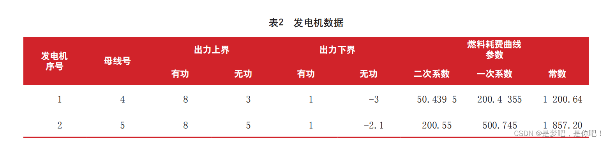

# Internal Point Method for Optimal Power Flow (Matlab Implementation)

Contents
1. Overview
2 Cases
2.1 Example description
2.2 Data
3. MATLAB implementation
1. Overview Due to the complexity of the power system itself, power flow optimization is characterized by its large scale, numerous constraints, and nonlinearity. By solving the optimal power flow, the ultimate goal is to optimize existing resources, reduce the cost of power generation plant consumption, decrease line losses in the power grid, and enhance the transmission capacity of the power system. Compared to traditional power flow calculations, it has good economic benefits. Therefore, optimal power flow is a topic of interest in the power system and currently, there are many studies on it.
The history of optimization methods is relatively short, primarily employing mathematical techniques to propose various optimization approaches and solutions for power system operations, providing a scientific basis for decision-making. The optimal power flow problem requires algorithms that not only converge quickly but also are simple in structure, with low computational requirements, so they can be solved using computers. Common methods for solving these problems include linear programming, quadratic programming, gradient and Newton-type algorithms, interior-point methods, and intelligent methods, among others.
2 Case Study 2.1 Example description: The objective function of the optimal power flow is to minimize system fuel consumption, and the calculation for the optimal power flow of the simplified system shown in Figure 2 is conducted. The parameters for line transmission power boundaries, generator active and reactive power output limits, and fuel consumption curves are presented in Tables 1 and 2 respectively. All data are given in the standardized form, with a power base value of 100 MV·A, and bus voltage upper and lower bounds of 1.1 and 0.9 respectively.
For the above system, in this example, there are a total of 5 nodes with corresponding state quantities.
​  
​  
2.2 Data
​  
3. Matlab implementation
3.2 Power Flow Calculation in the Power Distribution Network (Implemented with Python and Matlab)
3.3 Multi-objective Genetic Algorithm NSGAII for Microgrid Scheduling (Python & Matlab)
3.4 Economic Dispatch of Microgrids (Wind, Solar, Energy Storage)

## Images

<!-- PAYMENT_BLOCK -->

## Get this dataset

- Payment link (Stripe): [Buy now](https://buy.stripe.com/3cs8yP7sY87d0vu9AB)
- Payment QR code: 

<!-- /PAYMENT_BLOCK -->
